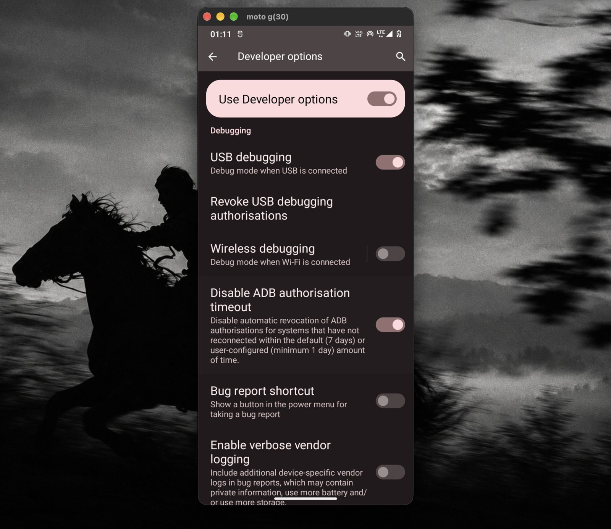
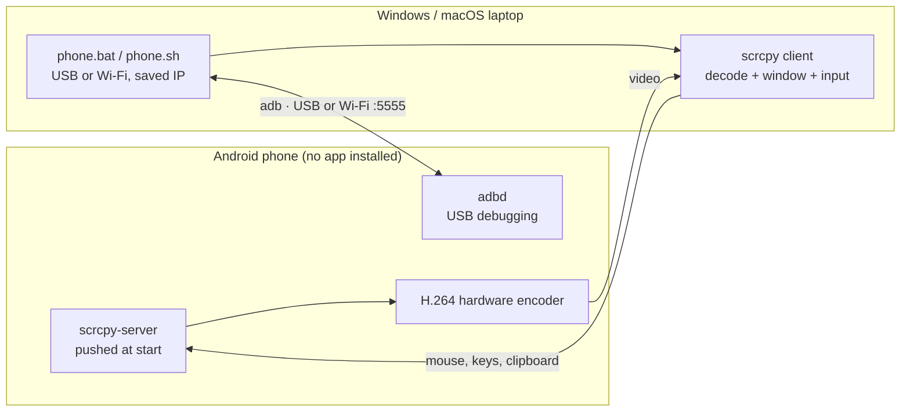

<div align="center">

# screenless

**Use an Android phone with a broken screen from any Windows or Mac laptop.**<br>
See it in a window, control it with your mouse and keyboard, over USB or Wi-Fi. No root, no app on the phone.


**[Windows guide →](docs/WINDOWS.md)** &nbsp;·&nbsp; [Website](https://screenless-psi.vercel.app) &nbsp;·&nbsp; [macOS guide](docs/MACOS.md) &nbsp;·&nbsp; [Troubleshooting](docs/TROUBLESHOOTING.md)



<sub>A real moto g30 with a broken display, mirrored and controlled on a Mac. Settings shown: USB debugging and "Disable ADB authorisation timeout", both on.</sub>

</div>

> Built by **[prutxvi](https://github.com/prutxvi)** with **Claude** (Anthropic's AI). My moto g30's display died but the phone still worked. I set the direction and made the calls; Claude did the diagnosis, measurements, scripts and docs.

## Contents
- [Features](#features)
- [Quick start (Windows)](#quick-start-windows)
- [Results](#results)
- [How it works](#how-it-works)
- [Repository layout](#repository-layout)
- [Compatibility and limits](#compatibility-and-limits)
- [Security](#security)
- [Credits and licences](#credits-and-licences)

## Features

| | What you get |
|---|---|
| **One-click launcher** | Double-click **Phone** on the Desktop. It uses USB if the cable is in, otherwise Wi-Fi, picks the right quality for each, and remembers the phone's IP. |
| **Works without the phone's screen** | Mouse, keyboard, clipboard and pattern unlock all work from the laptop. The phone's own display stays off, saving battery and the damaged panel. |
| **Wireless** | Run it once over USB and it switches the phone into wireless mode, so after that you need no cable. Quality drops automatically on weak Wi-Fi so frames keep arriving. |
| **Move between laptops** | Copy the phone's trusted key to a friend's laptop and the phone accepts it straight away, with no "Allow?" prompt on a screen you can't see. |
| **Speed tuning** | `tune` speeds up animations, keeps the phone awake and disables bloatware. Every change is reversible. |
| **AI setup** | [AGENTS.md](AGENTS.md) is a runbook that OpenCode, Claude Code or Codex can follow to set up a new laptop end to end. |
| **Phone agent** *(experimental)* | Claude uses the phone for you: *"open YouTube and search lofi"*. Anything that sends, pays or deletes waits for your approval. [agent/](agent/) |

## Quick start (Windows)

You need Windows 10/11, the phone with **USB debugging on** ([how](docs/WINDOWS.md#step-1--turn-on-usb-debugging-on-the-phone)), and a data USB cable.

```powershell
git clone https://github.com/prutxvi/screenless C:\screenless
cd C:\screenless\windows
powershell -ExecutionPolicy Bypass -File .\install.ps1     # installs scrcpy + a "Phone" Desktop shortcut
```

Plug in the phone, double-click **Phone** and tap **Allow** on the phone the first time. To go wireless, unplug and double-click **Phone** again.

Full walkthrough, every setting explained: **[docs/WINDOWS.md](docs/WINDOWS.md)**.

> [!TIP]
> Phone restarted and Wi-Fi stopped working? That's Android turning wireless mode off. Plug in, start **Phone** once, unplug. [Why, and how to automate it](docs/WIRELESS.md).

## Results

Measured on a Motorola moto g30 (Snapdragon 662, 4 GB RAM, Android 12). Details: [docs/PERFORMANCE.md](docs/PERFORMANCE.md).

| | Before | After | What changed |
|---|---:|---:|---|
| Free RAM | 650 MB | **860 MB** | Disabled 12 background bloat apps |
| Animation speed | 1.0× | **0.5×** | Screens open about twice as fast |
| Mirror goes black on Wi-Fi | Yes | **No** | Stay-awake that works without charging |
| Wi-Fi ping (2.4 GHz hotspot) | 166 ms avg, 690 ms peak | — | Network-bound; the fix is 5 GHz or USB, not a setting |

The biggest finding: **on a 4 GB phone, the lag is RAM and Wi-Fi, not the mirroring.** scrcpy streams through the phone's hardware H.264 encoder, so other mirroring apps can't beat it. They either wrap scrcpy or add latency.

## How it works



- **Nothing is installed on the phone.** scrcpy pushes a small server to the phone over adb each time it starts, and removes it when it stops.
- **Trust is a key pair.** When you tap *Always allow*, the phone stores the laptop's adb public key. Copying `adbkey` + `adbkey.pub` to another laptop makes it trusted too.
- **Wireless** is `adb tcpip 5555` while plugged in, then `adb connect <ip>:5555`. Android resets it on reboot.

## Repository layout

```
windows/
  install.ps1     One-time setup: scrcpy via winget, optional trusted key, Desktop shortcut
  phone.ps1       Launcher: USB or Wi-Fi, saved IP, tuned quality
  phone.bat       Double-click wrapper for phone.ps1
  tune.ps1        Animations, stay awake, optional debloat (all reversible)
macos/
  phone.sh        Same launcher for macOS
debloat/
  motorola.txt    Safe-to-disable package list (tested on moto g30)
agent/            Experimental: Claude drives the phone over adb
site/             Landing page (Vercel)
docs/             WINDOWS · MACOS · WIRELESS · PERFORMANCE · TROUBLESHOOTING
AGENTS.md         Setup runbook for AI coding agents
```

## Compatibility and limits

- **Tested on** a Motorola moto g30 (Android 12) with macOS. The Windows scripts follow the same flow and use scrcpy's official Windows build. Other Android 5+ phones should work.
- **USB debugging must already be on.** If the screen is too broken to turn it on, use a USB-C OTG mouse, or "Hey Google, open settings".
- **Wireless mode resets on every restart** (an Android rule without root). See [WIRELESS.md](docs/WIRELESS.md).
- Apps that block screenshots (some banking apps, DRM video) show as black in the mirror.
- Phone audio forwarding needs Android 11+.

## Security

- **`adbkey` is a private key.** Whoever has it can control the phone over USB, or over Wi-Fi when wireless mode is on. Keep it on a private USB stick, and never commit, upload or email it. `.gitignore` excludes it.
- Wireless mode accepts only computers whose key the phone already trusts, but it is still an open port on your network. Prefer trusted networks, and restart the phone to close it.
- The agent's approval gate asks before payments, messages, OTPs, orders and deletions, but it's a prototype. Watch it while it runs.

## Credits and licences

- **Our code** (launchers, tuning, agent, docs): [MIT](LICENSE).
- **[scrcpy](https://github.com/Genymobile/scrcpy)** by Genymobile, Apache-2.0. It does the actual mirroring and control. This project is a launcher, tuning layer and guide around it.
- **adb**, Android SDK Platform-Tools by Google, Apache-2.0.

Full list: [NOTICE](NOTICE).
